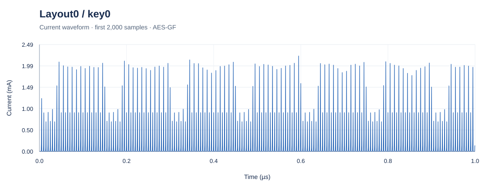

# Physical Design-Aware Power Dataset

Layout-specific current profiles for the **AES-GF hardware design**, supporting research in power side-channel analysis, secure physical design, and data-driven waveform modeling.

This dataset accompanies **[Physical Design-Aware Power Side-Channel Leakage Assessment Framework using Deep Learning](https://ieeexplore.ieee.org/document/11043283)** by Dipayan Saha, Jingbo Zhou, and Farimah Farahmandi, published in the proceedings of **IEEE ISCAS 2025**.

**If you use this dataset in your research, publications, or software, please cite the paper using the [citation below](#citation).**

## Contents

- [Research background](#research-background)
- [Dataset at a glance](#dataset-at-a-glance)
- [Waveform preview](#waveform-preview)
- [Directory structure](#directory-structure)
- [CSV format](#csv-format)
- [Getting started](#getting-started)
- [Working with multiple layouts](#working-with-multiple-layouts)
- [Research applications](#research-applications)
- [Citation](#citation)
- [Contributors and contact](#contributors-and-contact)

## Research background

Physical placement and routing influence a circuit's power signatures and, consequently, its side-channel behavior. Evaluating these effects before fabrication helps researchers investigate security during physical design.

The accompanying paper introduces **PD-PSC**, a graph neural network framework that predicts dynamic power traces for new layouts and uses those predictions to assess power side-channel leakage. The study evaluates AES-GF implementations and reports a **133× speedup** over its conventional simulation-based assessment flow. See the [published ISCAS paper](https://ieeexplore.ieee.org/document/11043283) for the methodology and experimental results.

This repository provides CSV current profiles organized by layout and key configuration for waveform exploration and comparative analysis.

## Dataset at a glance

The following figures describe the files included in this repository. A **sample** here means one CSV row containing a time/current measurement.

| Property | Value |
| --- | --- |
| Hardware design | AES-GF |
| Layout folders | **101**, named `Layout0` through `Layout100` |
| Key configurations per layout | **2**, named `key0` and `key1` |
| CSV files | **202** |
| Samples per CSV | **300,000** |
| Samples per layout, across both keys | **600,000** |
| Total samples | **60,600,000** |
| Columns per CSV | `sample_no`, `time`, `current` |
| Sample index range per CSV | `0`–`299999` |
| Recorded time range per CSV | `0`–`0.00015` seconds (**150 µs**) |
| CSV size | Approximately **9.12 MB** per file |
| Total CSV size | Approximately **1.84 GB** (decimal; excludes Git metadata) |
| File format | Plain-text CSV with a header row |

## Waveform preview

The waveform below shows the **first 2,000 samples** (sample indices `0`–`1999`) from **Layout0, key0**, covering `0`–`0.9995` microseconds. Each selected measurement is plotted in its original order, with time in microseconds and current in milliamperes.



[View source CSV](data/Layout0/key0/Layout0.csv) · [View waveform](assets/layout0-key0-waveform.svg)

To regenerate the preview from the CSV, run `python scripts/plot_waveform.py` from the repository root. This script uses only the Python standard library.

## Directory structure

```text
Physical-Design-Aware-Power-Dataset/
|-- README.md
|-- assets/
|   `-- layout0-key0-waveform.svg
|-- scripts/
|   `-- plot_waveform.py
`-- data/
    |-- Layout0/
    |   |-- key0/
    |   |   `-- Layout0.csv
    |   `-- key1/
    |       `-- Layout0.csv
    |-- Layout1/
    |   |-- key0/
    |   |   `-- Layout1.csv
    |   `-- key1/
    |       `-- Layout1.csv
    |-- ...
    `-- Layout100/
        |-- key0/
        |   `-- Layout100.csv
        `-- key1/
            `-- Layout100.csv
```

All layout folders are stored inside `data/`. Each layout has one CSV for each key configuration. The general path is:

```text
data/Layout{layout_id}/key{key_id}/Layout{layout_id}.csv
```

For example, `data/Layout23/key1/Layout23.csv` contains the current profile for layout **23** under configuration **key1**. Layout and key identifiers are encoded in the directory path; the CSV contains the measurements.

## CSV format

| Column | Type | Meaning | Unit |
| --- | --- | --- | --- |
| `sample_no` | Integer | Zero-based measurement index within the file | — |
| `time` | Floating point | Simulation time associated with the measurement | Seconds (s) |
| `current` | Floating point | Simulated current consumption | Amperes (A) |

The first rows of [`data/Layout0/key0/Layout0.csv`](data/Layout0/key0/Layout0.csv) are:

```csv
sample_no,time,current
0,0.0,3.53817e-07
1,5e-10,3.53817e-07
2,1e-09,3.53817e-07
3,1.5e-09,3.53817e-07
4,2e-09,3.53817e-07
```

Scientific notation is used for small values. For plotting, multiply `time` by `1e6` to obtain microseconds and `current` by `1e3` to obtain milliamperes. The `current` column is measured in amperes; power in watts can be calculated as `P(t) = V(t) × I(t)` when using the appropriate supply voltage.

## Getting started

### Download the dataset

Clone the repository, then run the examples from its root directory:

```bash
git clone https://github.com/sahadipayan/Physical-Design-Aware-Power-Dataset.git
cd Physical-Design-Aware-Power-Dataset
```

You can also download individual CSV files from the layout folders inside `data/` on GitHub when working with a subset of the dataset.

### Load one profile in Python

Install the packages used by these examples:

```bash
python -m pip install pandas matplotlib
```

```python
from pathlib import Path
import pandas as pd

root = Path(".")  # Repository root
layout_id = 0
key_id = 0
path = root / "data" / f"Layout{layout_id}" / f"key{key_id}" / f"Layout{layout_id}.csv"

profile = pd.read_csv(path)
print(profile.head())
print(f"Samples: {len(profile):,}")
print(profile[["time", "current"]].describe())
```

Expected sample count: **300,000**. To obtain a NumPy current array for further processing, use `profile["current"].to_numpy()`.

### Compare the two key configurations

This example plots the first 2,000 samples of both profiles for `Layout0`:

```python
from pathlib import Path
import pandas as pd
import matplotlib.pyplot as plt

root = Path(".")
layout_id = 0
fig, ax = plt.subplots(figsize=(10, 4))

for key_id in (0, 1):
    path = root / "data" / f"Layout{layout_id}" / f"key{key_id}" / f"Layout{layout_id}.csv"
    profile = pd.read_csv(path, nrows=2000)
    ax.plot(
        profile["time"] * 1e6,
        profile["current"] * 1e3,
        label=f"key{key_id}",
        linewidth=0.8,
        alpha=0.8,
    )

ax.set(title=f"Layout{layout_id}: current profiles", xlabel="Time (µs)", ylabel="Current (mA)")
ax.legend()
fig.tight_layout()
plt.show()
```

## Working with multiple layouts

For dataset-wide summaries, process one file at a time and retain the layout and key identifiers. The following example builds a compact table without loading all 60.6 million samples into memory together:

```python
from pathlib import Path
import pandas as pd

root = Path(".")
records = []

for layout_id in range(101):
    for key_id in (0, 1):
        path = root / "data" / f"Layout{layout_id}" / f"key{key_id}" / f"Layout{layout_id}.csv"
        current = pd.read_csv(path, usecols=["current"])["current"]
        records.append({
            "layout_id": layout_id,
            "key_id": key_id,
            "samples": len(current),
            "mean_current_A": current.mean(),
            "peak_current_A": current.max(),
        })

summary = pd.DataFrame(records)
print(summary.head())
print(f"Profiles summarized: {len(summary)}")  # 202
```

Use `nrows` for a quick preview, `usecols` to load only the measurements you need, or `chunksize` to read a file in batches. When evaluating generalization to new layouts, keep each layout's samples together when assigning training, validation, and test sets.

## Research applications

- **Layout comparisons:** examine how current profiles vary across physical implementations of the same hardware design.
- **Key-conditioned analysis:** compare `key0` and `key1` profiles within a layout.
- **Waveform modeling:** develop and evaluate models for current-profile prediction and feature extraction.
- **Side-channel research:** investigate key-dependent signal differences and statistical leakage measures.
- **Secure physical design:** explore relationships between physical implementation choices and observable current behavior.

## Citation

**Please cite the following paper when using this dataset**, and include a link to this repository so readers can locate the data.

Dipayan Saha, Jingbo Zhou, and Farimah Farahmandi, “Physical Design-Aware Power Side-Channel Leakage Assessment Framework using Deep Learning,” *2025 IEEE International Symposium on Circuits and Systems (ISCAS)*, pp. 1–5, 2025.

[IEEE Xplore](https://ieeexplore.ieee.org/document/11043283) | [DOI](https://doi.org/10.1109/ISCAS56072.2025.11043283)

```bibtex
@inproceedings{saha2025physical,
  author    = {Dipayan Saha and Jingbo Zhou and Farimah Farahmandi},
  title     = {Physical Design-Aware Power Side-Channel Leakage Assessment Framework using Deep Learning},
  booktitle = {2025 IEEE International Symposium on Circuits and Systems (ISCAS)},
  year      = {2025},
  pages     = {1--5},
  doi       = {10.1109/ISCAS56072.2025.11043283},
  url       = {https://ieeexplore.ieee.org/document/11043283}
}
```

## Contributors and contact

Prepared by researchers at **Silda Lab, University of Florida**.

**Dataset contributors:** Dipayan Saha and Farimah Farahmandi.

For questions, feedback, or dataset-related discussions, [open a GitHub issue](https://github.com/sahadipayan/Physical-Design-Aware-Power-Dataset/issues) or contact [dsaha@ufl.edu](mailto:dsaha@ufl.edu) or [dipayansahabd@gmail.com](mailto:dipayansahabd@gmail.com).
